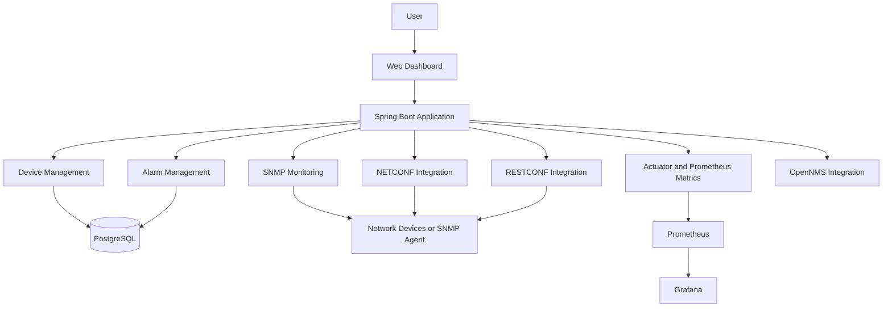

# Smart Campus Network Monitoring System

A multi-protocol network monitoring application built with **Java and Spring Boot** to monitor network devices, retrieve interface information, track alarms, and expose application metrics.

## Overview

Managing a campus network involves monitoring device availability, inspecting network interfaces, identifying issues, and keeping track of network health.

The **Smart Campus Network Monitoring System (Smart Campus NMS)** brings these capabilities together in a web-based application using multiple network management protocols and monitoring tools.

The project integrates SNMP-based interface monitoring with NETCONF and RESTCONF connectivity, a PostgreSQL database, Prometheus metrics, and OpenNMS integration.

## Key Features

- **Device Management:** Register and manage network device records.
- **SNMP Monitoring:** Retrieve network interface information and monitor interface status.
- **NETCONF Integration:** Provide a NETCONF client and service integration for network device management.
- **RESTCONF Integration:** Connect to network devices through RESTCONF.
- **Dashboard:** View device status, protocol connectivity, and monitoring information.
- **Alarm Management:** Store and manage network alarms.
- **Database Integration:** Use PostgreSQL and Spring Data JPA for persistent storage.
- **Application Metrics:** Expose metrics through Spring Boot Actuator and the Prometheus endpoint.
- **Network Monitoring Integration:** Integrate with OpenNMS.

## Technology Stack

| Category | Technologies |
|---|---|
| Language | Java |
| Backend | Spring Boot |
| Build Tool | Maven |
| API | Spring Web |
| Database | PostgreSQL |
| ORM | Spring Data JPA, Hibernate |
| Network Monitoring | SNMP4J |
| Network Configuration | NETCONF, RESTCONF |
| Metrics | Spring Boot Actuator, Micrometer, Prometheus |
| Visualization | Grafana |
| Network Management | OpenNMS |
| Testing | JUnit, Spring Boot Test |
| Version Control | Git, GitHub |

## Architecture



*The diagram represents the main application components and integrations. Actual connectivity depends on the configured devices and monitoring services.*

## Project Structure

```text
smart-campus-nms/
├── .mvn/
├── src/
│   ├── main/
│   │   ├── java/com/network/management/nms/
│   │   │   ├── controller/
│   │   │   ├── model/
│   │   │   ├── network/
│   │   │   │   ├── netconf/
│   │   │   │   ├── restconf/
│   │   │   │   └── snmp/
│   │   │   ├── repository/
│   │   │   ├── service/
│   │   │   └── SmartCampusNmsApplication.java
│   │   └── resources/
│   │       ├── application.properties
│   │       └── static/dashboard.html
│   └── test/
├── pom.xml
├── mvnw
├── mvnw.cmd
└── README.md
```

## Prerequisites

Install or configure the following before running the application:

- Java version compatible with the project configuration
- PostgreSQL
- Maven, or use the included Maven Wrapper
- IntelliJ IDEA or another Java IDE
- A reachable SNMP agent or supported network device
- Optional monitoring services: Prometheus, Grafana, and OpenNMS
- Network-device credentials and access for NETCONF/RESTCONF integrations

## Setup and Installation

### 1. Clone the repository

```bash
git clone https://github.com/Jitendra-B21/smart-campus-network-monitoring-system.git
cd smart-campus-network-monitoring-system
```

### 2. Create the PostgreSQL database

Create a PostgreSQL database named:

```sql
CREATE DATABASE smart_campus_nms;
```

Ensure that your PostgreSQL service is running.

### 3. Configure environment variables

The application reads database credentials and network integration settings from environment variables.

Configure these variables in your IDE's run configuration or your local terminal:

| Variable | Purpose |
|---|---|
| `DB_URL` | PostgreSQL JDBC URL |
| `DB_USERNAME` | Database username |
| `DB_PASSWORD` | Database password |
| `NETCONF_HOST` | NETCONF device hostname |
| `NETCONF_PORT` | NETCONF port |
| `NETCONF_USERNAME` | Network-device username |
| `NETCONF_PASSWORD` | Network-device password |
| `RESTCONF_HOST` | RESTCONF device hostname |
| `RESTCONF_PORT` | RESTCONF port |
| `OPENNMS_URL` | OpenNMS base URL |
| `OPENNMS_USERNAME` | OpenNMS username |
| `OPENNMS_PASSWORD` | OpenNMS password |

The current configuration uses the NETCONF credential variables for both NETCONF and RESTCONF authentication settings.

Do not commit real passwords, API tokens, or private credentials to GitHub.

### 4. Run the application

On Windows PowerShell:

```powershell
.\mvnw.cmd spring-boot:run
```

Alternatively, open the project in IntelliJ IDEA, configure the environment variables in the run configuration, and run `SmartCampusNmsApplication`.

### 5. Open the application

Once the application starts, open:

- **Dashboard API:** `http://localhost:8080/api/dashboard`
- **Health endpoint:** `http://localhost:8080/actuator/health`
- **Prometheus metrics:** `http://localhost:8080/actuator/prometheus`

The web dashboard is served from the application's static resources. The exact dashboard URL depends on the application's configured routes.

## Monitoring Integrations

### SNMP

SNMP4J is used for SNMP communication and network-interface monitoring. The application can retrieve interface information from a reachable, configured SNMP agent.

### NETCONF and RESTCONF

Dedicated clients and service components provide integration with NETCONF and RESTCONF. Successful communication depends on device support, network reachability, valid credentials, and compatible configuration.

**Status-check limitation:** The dashboard's NETCONF and RESTCONF connectivity indicators may use lightweight TCP reachability checks. A successful TCP connection alone does not prove that protocol authentication or a configuration operation succeeded.

### Prometheus and Grafana

Spring Boot Actuator and Micrometer expose application metrics through the Prometheus endpoint. Prometheus can scrape these metrics, and Grafana can visualize them when configured.

### OpenNMS

The project includes an OpenNMS integration for working with an external network monitoring system. OpenNMS must be configured and reachable for the integration to work.

## Testing

Run the project's test suite using the Maven Wrapper:

```powershell
.\mvnw.cmd test
```

Test results depend on the available configuration and test environment.

## Future Improvements

- Add authentication and role-based authorization.
- Introduce configurable monitoring intervals and device groups.
- Improve alarm severity classification and notification workflows.
- Add historical interface-performance charts.
- Expand automated tests for network protocol clients.
- Add Docker-based setup for easier local deployment.
- Implement more comprehensive integration tests with simulated network devices.
- Add screenshots, demonstrations, and deployment documentation.

## Learning Outcomes

This project provides practical experience with:

- Building a Java backend using Spring Boot.
- Designing REST APIs and layered application components.
- Integrating network management protocols.
- Persisting monitoring data with PostgreSQL and JPA.
- Exposing application metrics for monitoring.
- Managing source code using Git and GitHub.

## Author

**Jitendra B.**

B.Tech — Artificial Intelligence and Machine Learning

REVA University

GitHub: [Jitendra-B21](https://github.com/Jitendra-B21)

---

*This project is developed for learning and demonstration purposes. Actual monitoring capabilities depend on the configured network devices, credentials, and external services.*
